# 工作空间优化

一个给 AI 助手用的技能：让持续几天、几十轮的项目**不失忆**。

进度看得见、决定可追溯、换个对话三十秒接上。

> 一个「技能」就是一份写给 AI 的操作手册：它规定 AI 在特定场景下该怎么走流程，而不是每次临场发挥。

## 目录

- [它解决什么问题](#它解决什么问题)
- [它管五件事](#它管五件事)
- [它怎么运转](#它怎么运转)
- [装上它](#装上它)
- [技能包里是什么](#技能包里是什么)
- [环境要求](#环境要求)
- [许可证](#许可证)

---

## 它解决什么问题

用多轮对话做一个持续几天的项目，最大的敌人不是 AI 不够聪明，是**失忆**：

- 上次改到哪一步了？
- 当时为什么这么定，能不能改？
- 这个文件还有人用吗，删了会不会出事？
- 换了新对话，怎么让它三十秒内接上？

「工作空间优化」就是给 AI 装一套**项目记账本**：进度看得见、决定可追溯、换对话接得上。

## 它管五件事

| 能力 | 你说什么 | 它做什么 |
|---|---|---|
| 启动项目 | "启动项目：XX" | 先问两个问题，再按最小骨架铺（默认只建 `output/`，不整套铺） |
| 接手项目 | "接手项目，路径：X" | 只读盘点 → 问三件事 → 加壳不改原文件 |
| 升级项目 | "升级项目" | 技能规则更新后，把老项目的规则文件对齐 |
| 开工 | "开工" / "继续做" | 按预算读文件 → 给提醒 → 三行现状 → 等你确认 |
| 收尾 | "收尾" | 核对产物 → 刷新看板 → 按判据清退废弃件 → 出一张分区表 |

附带一个目录体检脚本：扫目录膨胀、孤儿文件、规则与实际不一致。

## 它怎么运转



一句话触发 → 主入口路由 → 按需读细节 → 产物落进项目目录 → 下一轮「开工」从落盘处接上。

主线上的光点是数据流，底下那条虚线是回环。**技能本身不存状态**：状态全部落在项目里（规则副本、看板、项目宪法、记忆），所以换一个对话，读回那几份文件就能接上。

## 装上它

技能是**目录**形式的。把整个仓库目录拷到客户端的技能目录下：

```bash
git clone https://github.com/foryys/workbuddy-z-kongjian.git
```

| 系统 | 位置 |
|---|---|
| Windows | `%USERPROFILE%\.workbuddy\skills\workbuddy-z-kongjian\` |
| macOS / Linux | `~/.workbuddy/skills/workbuddy-z-kongjian/` |

把 clone 下来的 `workbuddy-z-kongjian` 整个文件夹放进去即可。

**目录名必须保持 `workbuddy-z-kongjian`** —— 它与 `SKILL.md` 里的 `name` 字段一致，改名会导致技能加载失败。

装好后开一个新会话生效。想让 AI 干活时说人话即可：`启动项目：XXX`、`收尾`、`瘦身`。

## 技能包里是什么

```
workbuddy-z-kongjian/
├── SKILL.md                 主入口：功能地图 + 当前生效的规则（AI 每一轮都读这份）
├── references/              细节文档，按需加载
│   ├── 新项目.md            启动项目怎么铺骨架
│   ├── 接手项目.md          接手 / 升级 / 清空重做
│   ├── 开工.md              每轮开工的读文件预算与三行汇报
│   ├── 收尾.md              产物核对、看板刷新、废弃件清退判据
│   ├── 目录纪律.md          什么该放哪、命名与归档规则
│   ├── 环境注意.md          Windows 环境实测踩坑（路径、回收站、编码）
│   ├── project-rules.md     规则文件原件
│   └── 复盘与并行.md        阶段复盘、多会话并行
├── assets/                  模板：新项目时复制出去的骨架
│   ├── WORKBUDDY.md         项目宪法模板
│   ├── 工作空间规则-本项目.md
│   └── 看板.html            项目看板模板
├── scripts/
│   └── 体检.py              目录体检脚本
└── docs/
    └── skill-architecture-flow.svg   上面那张架构图
```

## 环境要求

- 面向支持 `SKILL.md` 格式的客户端
- 体检脚本需要 **Python 3.8+**，只用标准库，无第三方依赖
  ```bash
  python scripts/体检.py [项目根目录]   # 不传则体检当前目录
  ```
- `references/环境注意.md` 里大量条目来自 **Windows** 实测（盘符、回收站、命令行编码）。macOS / Linux 上这部分不完全适用，按需忽略。

## 许可证

**署名—非商业性使用—相同方式共享 4.0**（CC BY-NC-SA 4.0）。

你可以阅读、修改、分享，条件是三条：

- **署名** —— 注明出处
- **非商业** —— 不用于商业目的
- **相同方式共享** —— 改后的版本用同一个许可证发布

法律全文见 [LICENSE](LICENSE)。要商用请另外联系我。
